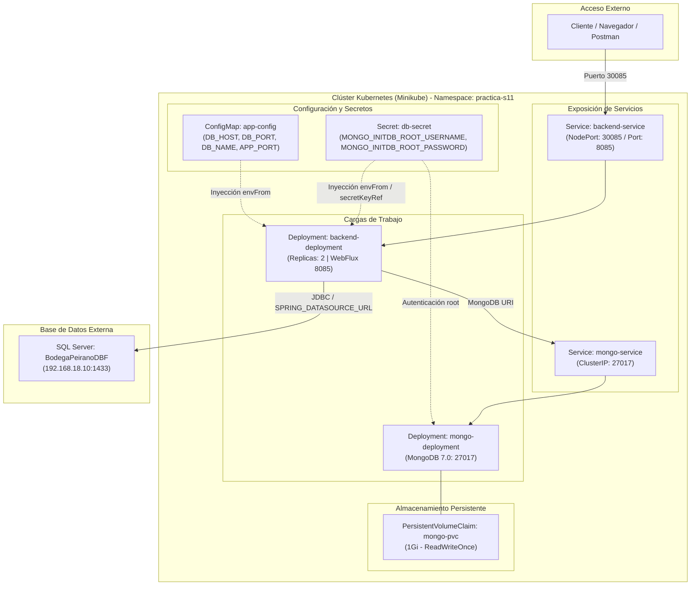

# 🚀 Despliegue de Backend Spring Boot WebFlux y MongoDB en Kubernetes (Minikube)


Este repositorio contiene los manifiestos de **Kubernetes** para el despliegue y orquestación de una solución backend reactiva desarrollada con **Spring Boot WebFlux**, integrada con **MongoDB** (almacenamiento persistente) y conectividad a **Microsoft SQL Server**, configurado para entornos locales de desarrollo mediante **Minikube**.

---

## 📌 Arquitectura del Sistema



---

## 📁 Estructura de Manifiestos (`k8s/`)

Los manifiestos se encuentran numerados según el orden recomendado de despliegue:

| Manifiesto | Tipo de Recurso | Función Principal |
| :--- | :--- | :--- |
| [`00-namespace.yaml`](k8s/00-namespace.yaml) | `Namespace` | Crea y aisla el entorno lógico `practica-s11`. |
| [`01-mongo-pvc.yaml`](k8s/01-mongo-pvc.yaml) | `PersistentVolumeClaim` | Solicita 1Gi de almacenamiento persistente para MongoDB. |
| [`02-app-configmap.yaml`](k8s/02-app-configmap.yaml) | `ConfigMap` | Variables de entorno no sensibles del backend (hosts, puertos, DB). |
| [`03-db-secret.yaml`](k8s/03-db-secret.yaml) | `Secret` | Credenciales de base de datos en Base64 (`MONGO_INITDB_ROOT_*`). |
| [`04-mongo-stack.yaml`](k8s/04-mongo-stack.yaml) | `Deployment` + `Service` | Instancia de MongoDB 7.0 con sondas (liveness/readiness) y ClusterIP. |
| [`05-backend-stack.yaml`](k8s/05-backend-stack.yaml) | `Deployment` + `Service` | 2 réplicas del Backend WebFlux y servicio NodePort (30085). |

---

## ⚙️ Requisitos Previos

- [Minikube](https://minikube.sigs.k8s.io/docs/start/) (v1.30 o superior)
- [kubectl](https://kubernetes.io/docs/tasks/tools/) instalado y configurado
- Docker Desktop u otro driver compatible configurado para Minikube
- PowerShell 5.1+ o terminal compatible (Bash, Zsh)

---

## 🚀 Guía de Despliegue

### 1. Iniciar el clúster local de Minikube

```powershell
minikube start --driver=docker
